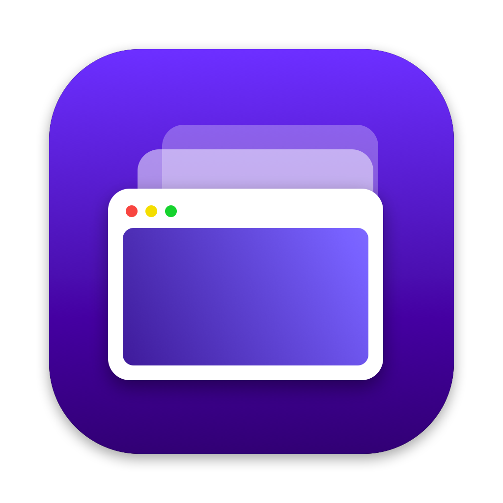

# Vista

Virtual machines for Apple silicon, on Apple's own Virtualization framework (more coming soon).

Pick a system and Vista finds the current installer at its publisher,
downloads and verifies it, builds the machine and boots it. Machines run side
by side, each in its own process, with snapshots that take no time and no
space, and a menu bar quick view to start and stop them. A built-in MCP
server lets coding agents do all of it too — and see the screen, type, click,
and run commands inside the guest.

No accounts, no licence keys, no telemetry, no splash screens.



## Highlights

- **One-click systems.** macOS (latest, 26, 15, 14, 13), Ubuntu, Fedora,
  Debian, Kali, CentOS Stream, Rocky, AlmaLinux, openSUSE, Pop!_OS, NixOS,
  Alpine, FreeBSD, OpenBSD, NetBSD — and, experimentally, Windows 11 for Arm,
  downloaded from Microsoft and installed unattended. Or any Arm64 ISO or
  macOS restore image you already have. Entries name no point releases:
  "Ubuntu 26.04" means 26.04.1 the day it ships. → [Systems](docs/systems.md)
- **Hands-off setup.** On a macOS 27 host, new macOS machines get their first
  account created and skip Setup Assistant. Linux installers are ejected by
  themselves when the install is done. → [Machines](docs/machines.md)
- **Snapshots, suspend, clones.** APFS copy-on-write snapshots, instant and
  free until the machine changes; taken while running, they keep memory too.
  Suspend writes memory to disk and resumes in seconds.
  → [Snapshots](docs/snapshots.md)
- **Sharing.** Mac folders in the guest over virtio-fs, clipboard for Linux,
  Rosetta for x86-64 Linux programs, the guest's address on the shared network.
  → [Sharing](docs/sharing.md), [Hardware](docs/hardware.md)
- **Menu bar quick view** of every machine, with start and stop.
  → [The menu bar](docs/menubar.md)
- **Agents, inside and out.** `vistamcp` has 43 tools: machine lifecycle,
  configuration, snapshots and creation jobs from the outside; screenshots,
  keyboard and pointer for any guest; commands and files inside Linux and
  macOS guests through Vista Tools. → [Agents](docs/agents.md)

## Getting started

Requirements: a Mac with Apple silicon, macOS 15 or later (macOS 27 adds
Secure Boot and first-account setup for macOS guests), and Rust 1.94+ to
build.

```sh
rustup target add aarch64-unknown-linux-musl   # once: Vista Tools for Linux guests
scripts/bundle.sh                              # -> dist/Vista.app
```

Drag `dist/Vista.app` to Applications, open it, and choose **New Machine**.
More in [Installing Vista](docs/install.md).

For development:

```sh
cargo build && scripts/tools.sh && scripts/sign.sh
target/debug/vista
```

`scripts/sign.sh` matters: the Virtualization framework only runs machines in
processes signed with the virtualization entitlement.
See [Building and contributing](docs/building.md).

## Connecting an agent

Point any MCP-capable agent at the server:

```json
{
  "mcpServers": {
    "vista": { "command": "/Applications/Vista.app/Contents/MacOS/vistamcp" }
  }
}
```

Settings → Agents shows the path for your copy and turns agent control off
for the whole Mac; each machine can be excluded on its own. See
[Agents](docs/agents.md) and the [tool reference](docs/tools.md).

## Documentation

| | |
| --- | --- |
| [Installing Vista](docs/install.md) | Requirements, the app, first launch, where Vista keeps things |
| [Creating and running machines](docs/machines.md) | Picking a system, creation jobs, the machine page and window |
| [Systems](docs/systems.md) | Every one-click system and how its installer is found |
| [Hardware](docs/hardware.md) | Processors, memory, disk, display, network, sound, USB |
| [Sharing](docs/sharing.md) | Shared folders, clipboard, Rosetta |
| [Snapshots, suspend and clones](docs/snapshots.md) | What each saves, and reverting |
| [The menu bar](docs/menubar.md) | The quick view |
| [Settings and shortcuts](docs/settings.md) | Preferences, menus, key bindings |
| [Windows](docs/windows.md) | Windows 11 for Arm, and what's experimental about it |
| [Agents](docs/agents.md) | The MCP server |
| [MCP tool reference](docs/tools.md) | All 43 tools |
| [Vista Tools](docs/guesttools.md) | The agent inside the guest |
| [Architecture](docs/architecture.md) | Processes, crates, the bundle, the database |
| [Protocols](docs/protocol.md) | The control socket and Vista Tools protocols |
| [Building and contributing](docs/building.md) | Building, signing, tests, conventions |
| [Troubleshooting](docs/troubleshooting.md) | Logs and common problems |

## Limits worth knowing

- **Windows is experimental.** Apple's framework doesn't support it; Vista
  relies on unpublished framework switches. The download and the install
  disk work; a full install on this framework hasn't been verified.
  → [Windows](docs/windows.md)
- **Bridged networking** needs an entitlement Apple grants per developer.
  Shared (NAT) networking always works.
- **A guest reboot powers the machine off** — the framework reports both the
  same way.
- **Screenshots need the machine's window on screen**; a hidden machine is
  shown first. Apple allows **two macOS guests** at a time.

## Built with

Rust, [gpui](https://github.com/zed-industries/zed) and
[guise](https://github.com/wess/guise) for the interface, tokio, sqlx and
SQLite, and [objc2](https://github.com/madsmtm/objc2) for the Virtualization
framework and AppKit.

## License

Apache License 2.0. See [LICENSE](LICENSE).
